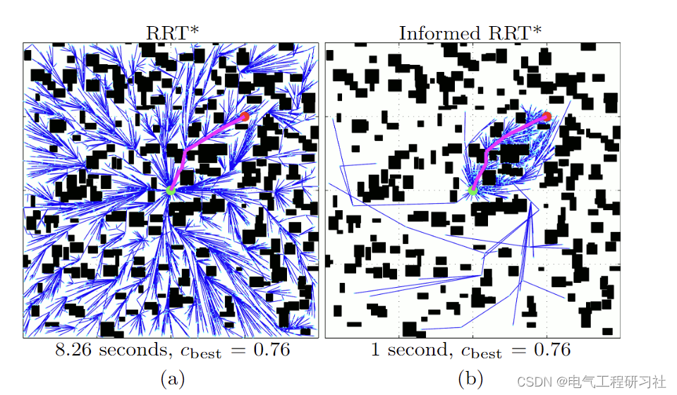
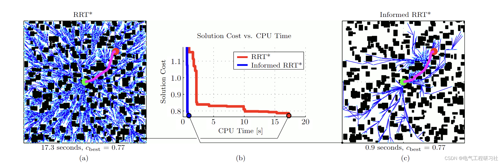
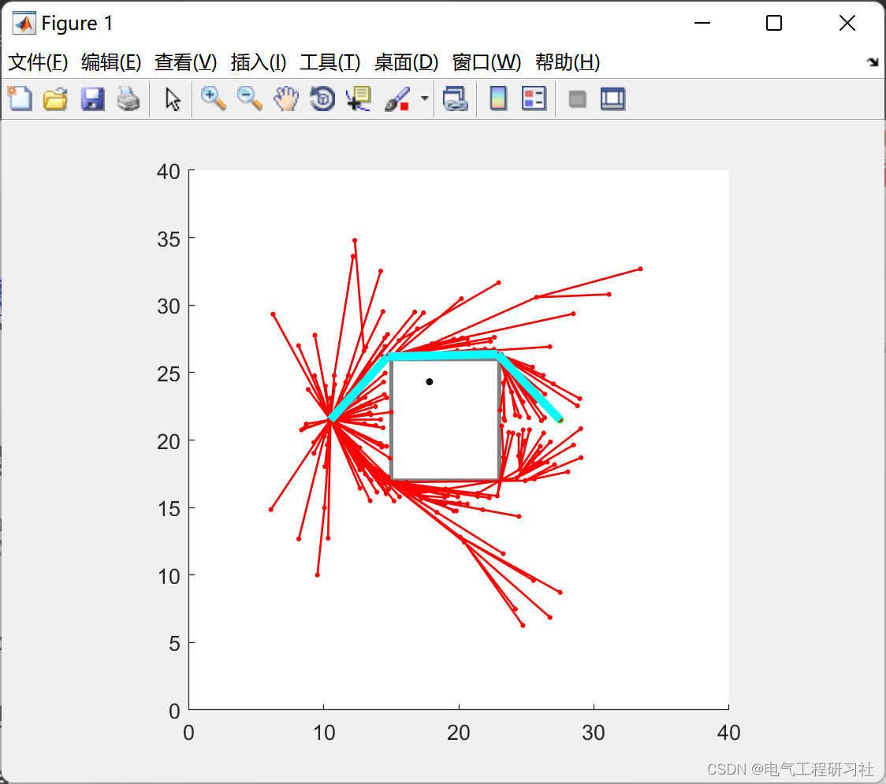
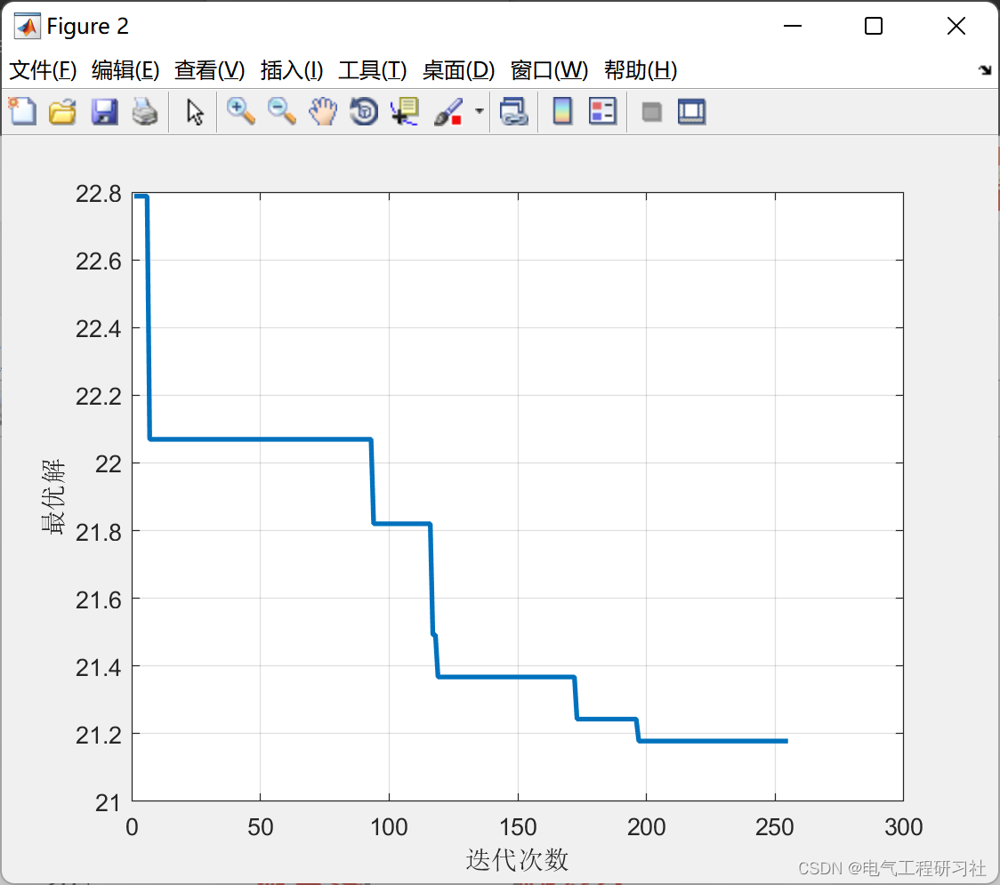
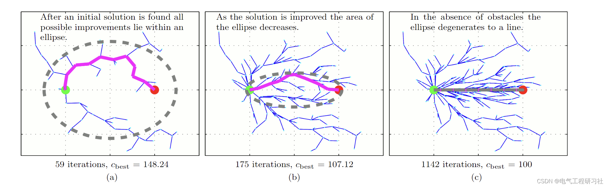
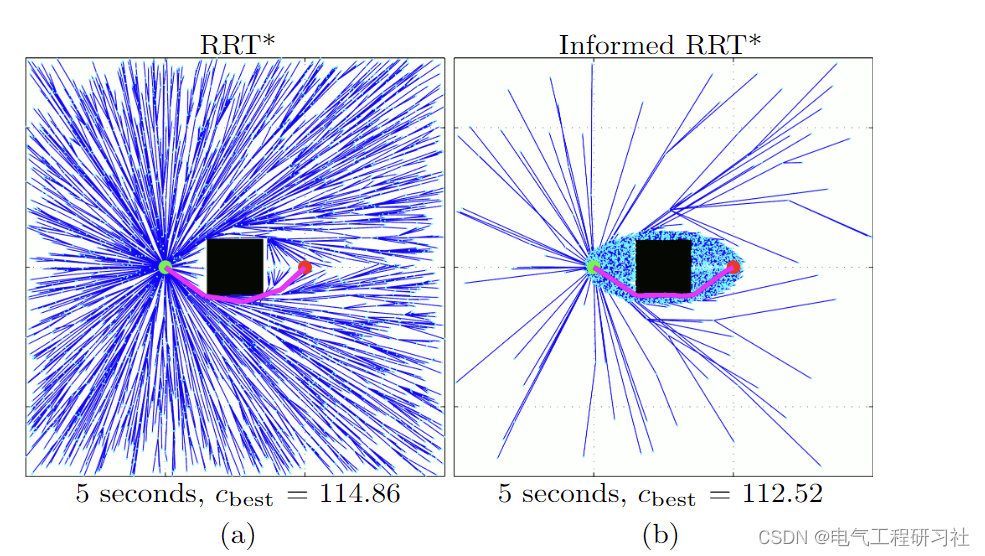
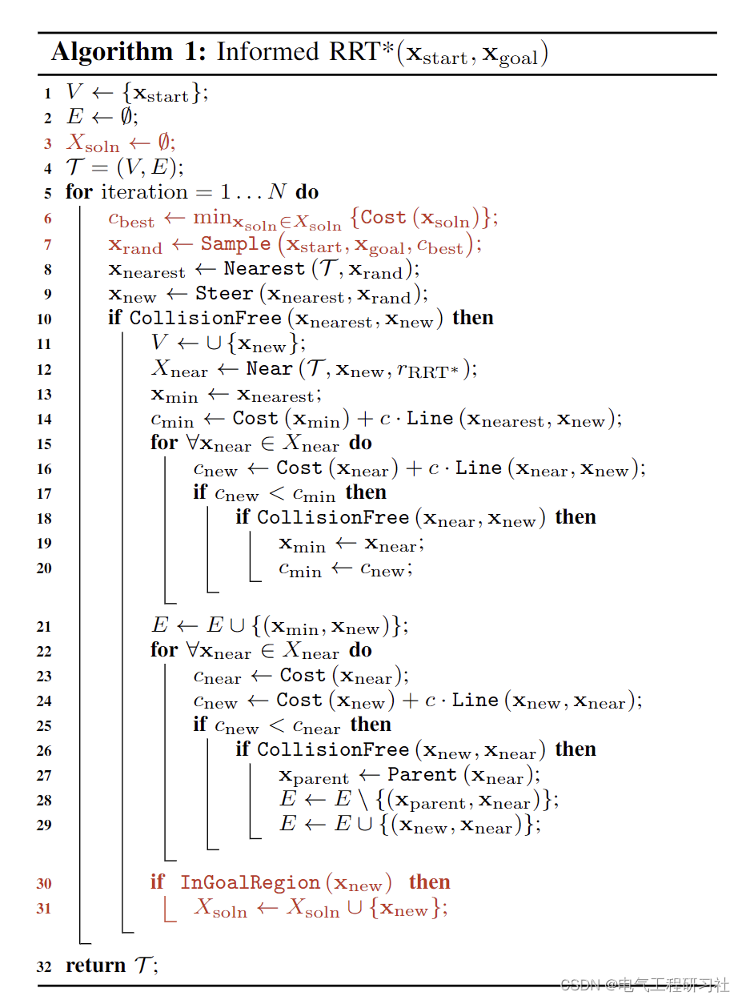
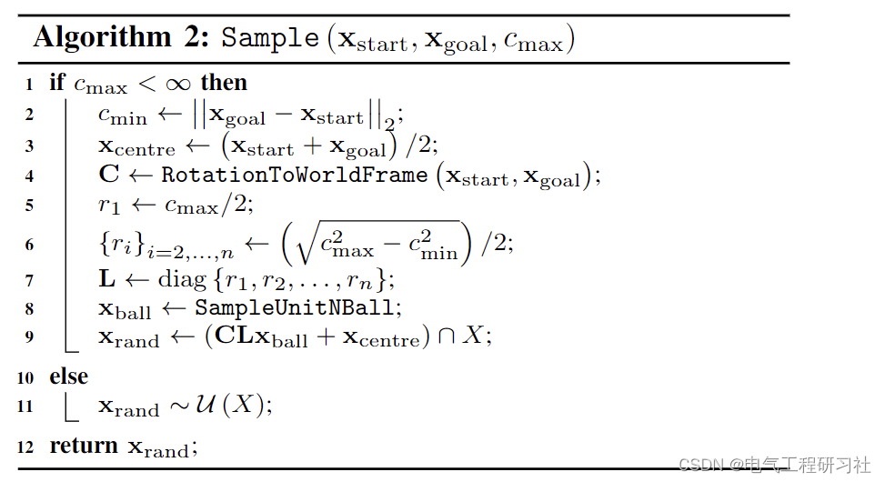

# [Path Optimization] Global Path Planning Based on Improved RRT Algorithm (Matlab Code Implementation)

​  
1 Overview of Rapidly-exploring Random Trees (RRT) in motion planning, which are popular due to their ability to effectively find solutions for single query problems. Optimal RRT (RRT*s) extend RRT to the problem of finding an optimal solution, but this is done asymptotically by finding the optimal path from the initial state to each state in the planning domain. This behavior is not only inefficient but also inconsistent with their single query nature. For problems seeking to minimize the length of the path, the subset of states that can be improved upon can be described using long hyperspheres. We show that unless direct sampling of this subset is performed, the probability of improving upon the solution becomes arbitrary small in large worlds or high state dimensions. In this paper, we propose a precise method for centralized search through direct sampling of this subset. The advantages of the proposed sampling technique are demonstrated through a new algorithm, Informed RRT*. This method retains the same integrity and optimality probability guarantee as RRT* while increasing the convergence speed and the quality of the final solution. We present this algorithm as a simple modification of RRT* that can be further extended with higher-level path planning algorithms. We demonstrate its superiority over RRT* in terms of convergence speed, cost of the final solution, and ability to find difficult channels, while also showing less dependence on the state dimension and range of the planning problem.
Editor
Editor
2 Mathematical Models
Detailed mathematical models are available in Part 5.
3. Running Results Editing
Editor
Editor
Editor
4 Process flow diagram editing
5. Matlab code and detailed explanation of the article. This article only showcases a portion of the code, all code and articles can be found in:
Editor
​  

## Images

<!-- PAYMENT_BLOCK -->

## Get this dataset

- Payment link (Stripe): [Buy now](https://buy.stripe.com/3cs8yP7sY87d0vu9AB)
- Payment QR code: 

<!-- /PAYMENT_BLOCK -->
